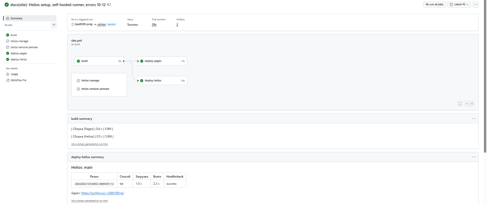
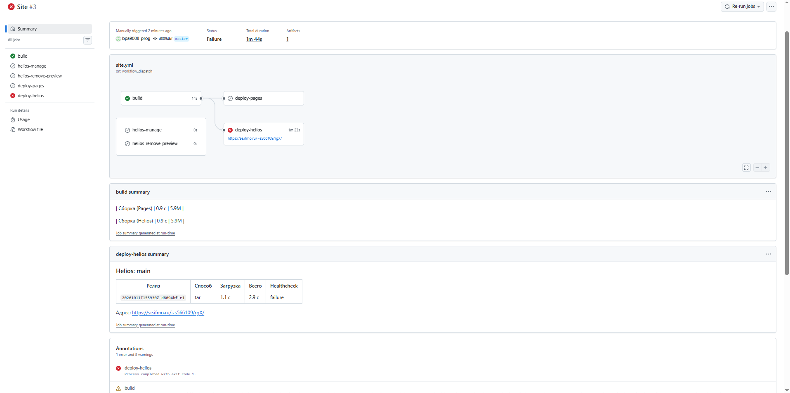
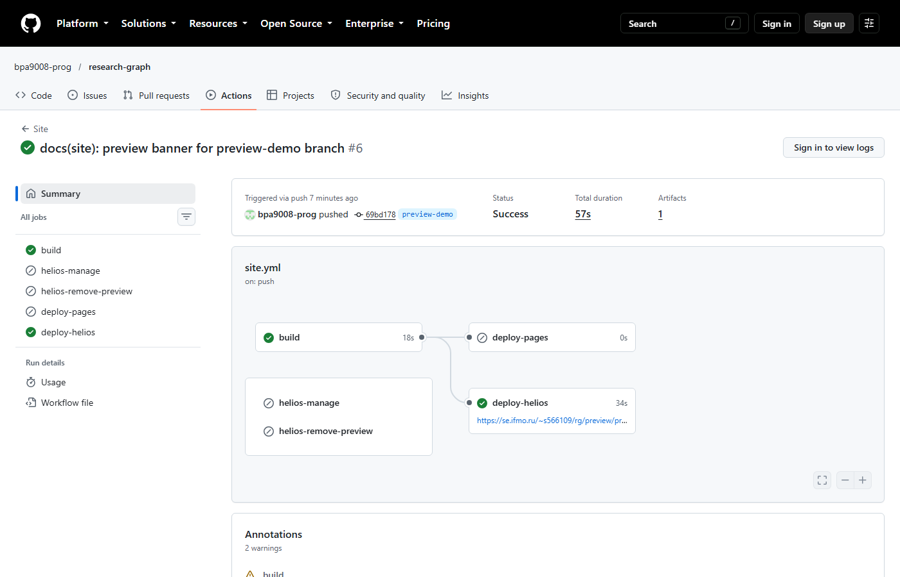
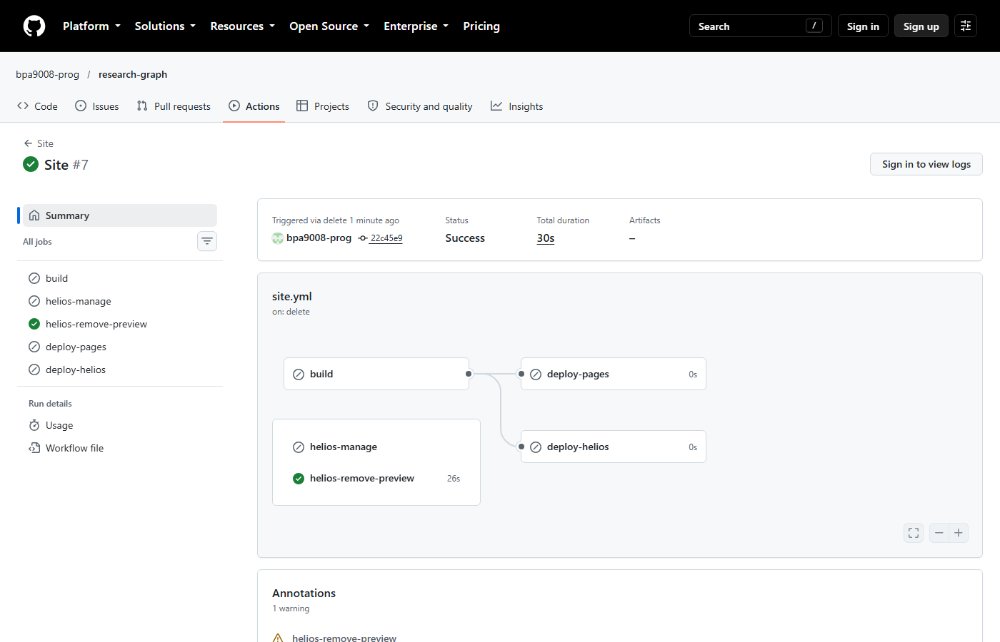
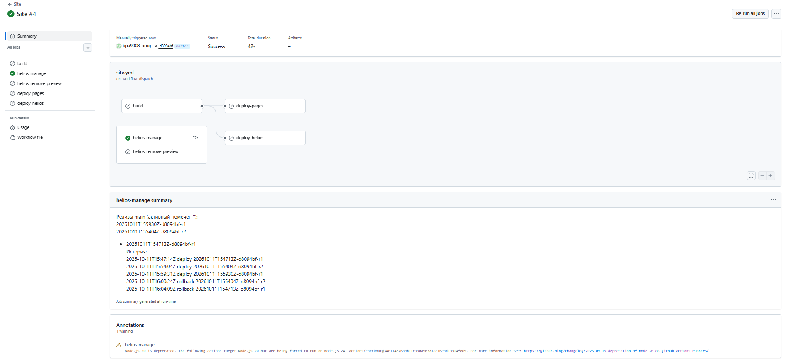

# P4. Развёртывание на Helios с контролем качества доставки

## Что реализовано

| Требование | Как сделано | Где |
|---|---|---|
| Выкладка по SSH/rsync с отдельным deploy-ключом | `rsync` с `--link-dest`, при отсутствии rsync на сервере — `tar` через `ssh` | `scripts/helios.sh` |
| Healthcheck после выкладки | код 200, контрольная строка с хешем коммита, поиск, MathJax, код 404 для несуществующего адреса | `scripts/healthcheck.sh` |
| Preview-сборки | ветка `feature/x` → `preview/feature-x/`, `master` → корень | job `build`, шаг «Куда публиковать» |
| Откат | хранятся 5 последних релизов, автоматический откат при провале healthcheck, ручной — из интерфейса Actions | `scripts/helios-remote.sh`, job `helios-manage` |
| Устойчивость к обрыву | загрузка в `.partial`, переключение одной операцией после полной загрузки | `scripts/helios-remote.sh` |
| Уборка | удаление ветки удаляет её preview | job `helios-remove-preview` |
| Доступ к Helios из CI | job выкладки идут на self-hosted runner с российским IP: Helios не принимает SSH из-за рубежа | `runs-on: [self-hosted, helios]` |

## Устройство

### Раскладка на сервере

```text
~/rg-site/
├── releases/
│   ├── main/
│   │   ├── 20261011T120000Z-dddd444-r1/     ← неизменяемые релизы
│   │   ├── 20261012T090000Z-1a2b3c4-r1/
│   │   └── 20261012T091500Z-5e6f7a8-r1/     ← активный
│   └── preview--feature-t4/
│       └── 20261012T080000Z-eeee555-r1/
├── previews/
│   └── feature-t4 → ../releases/preview--feature-t4/20261012T080000Z-eeee555-r1
└── state/
    ├── main.current                         ← id активного релиза
    └── main.history                         ← журнал выкладок и откатов
~/public_html/rg → ~/rg-site/releases/main/20261012T091500Z-5e6f7a8-r1
                     └── preview → ~/rg-site/previews
```

Имя релиза — время UTC, короткий хеш коммита и номер попытки запуска.
Имена сортируются по времени, по ним видно, из какого коммита собран релиз.

### Последовательность выкладки

```text
раннер                                   Helios
  │  prepare main <id>  ───────────────►  mkdir releases/main/<id>.partial
  │  ◄── upload=…, previous=<id>, rsync=…
  │  rsync --link-dest=../<previous> ──►  только изменившиеся файлы,
  │                                       остальные — жёсткие ссылки
  │  finalize main <id> ───────────────►  mv <id>.partial → <id>
  │                                       ~/public_html/rg → <id>  (rename)
  │                                       удалить старые релизы сверх 5
  │  healthcheck https://…/rg/ <sha>
  │  ── провал? ── rollback main <previous> ──► ~/public_html/rg → <previous>
```

Все команды на сервере выполняет один скрипт на POSIX sh. Он передаётся
через `ssh … sh -s -- <команда> < helios-remote.sh` и работает при любой
оболочке входа на Helios (sh, bash, tcsh). На сервере ничего не нужно
устанавливать заранее.

### Два режима активации

| | `symlink` (по умолчанию) | `swap` |
|---|---|---|
| Что такое `~/public_html/rg` | символическая ссылка на релиз | обычный каталог, копия релиза |
| Переключение | одно переименование ссылки, атомарно | `cp -R` в `rg.new`, затем два переименования каталогов |
| Окно, когда сайт в промежуточном состоянии | нет | миллисекунды между двумя `mv` |
| Место на диске | релизы (с `--link-dest` — только изменённые файлы) | релизы + живая копия |
| Требования к веб-серверу | Apache следует по ссылкам (`FollowSymLinks` или `SymLinksIfOwnerMatch`) | никаких |

Режим выбирается переменной `HELIOS_MODE`. Если веб-сервер Helios не ходит
по символическим ссылкам, healthcheck получит 403 на первой же выкладке, и
режим нужно сменить на `swap`. Скрипт и workflow для этого не меняются.

## Настройка { #setup }

### 1. Deploy-ключ

```bash
ssh-keygen -t ed25519 -N '' -C 'research-graph deploy (GitHub Actions)' -f helios_deploy
```

Открытую часть — на Helios, в `~/.ssh/authorized_keys`, одной строкой с
ограничениями. Заодно создаётся каталог, который отдаёт веб-сервер:

```bash
umask 022
mkdir -p ~/.ssh && chmod 700 ~/.ssh
echo 'restrict ssh-ed25519 AAAAC3NzaC1lZDI1NTE5AAAAICvx61TBodMtS3JApa8ZE3B6QPePC8BRNsoSNWNRAkDn research-graph deploy (GitHub Actions)' >> ~/.ssh/authorized_keys
chmod 600 ~/.ssh/authorized_keys
mkdir -p ~/public_html && chmod 755 ~/public_html && chmod o+x ~
```

`restrict` запрещает проброс портов и агентов, X11 и терминал. Выкладке они
не нужны, а украденный ключ без них не откроет туннель в сеть университета.
Приватную часть — в секрет окружения, после чего локальный файл удалить.

### 2. Ключ хоста

Порядок получения и сверки описан в [T4](t4-security.md#known-hosts).
Результат:

```text
[helios.cs.ifmo.ru]:2222 ssh-ed25519 AAAAC3NzaC1lZDI1NTE5AAAAILr5dsbF6eEBT5UFKGo1Qe3ina64YppvFELt8Wu+cZM1
```

### 3. Окружение `helios` в репозитории

**Settings → Environments → New environment → `helios`**:

| Имя | Тип | Значение |
|---|---|---|
| `HELIOS_SSH_KEY` | секрет | содержимое файла `helios_deploy` |
| `HELIOS_KNOWN_HOSTS` | переменная | строка из шага 2 |
| `HELIOS_HOST` | переменная | `helios.cs.ifmo.ru` |
| `HELIOS_PORT` | переменная | `2222` |
| `HELIOS_USER` | переменная | `s566109` |
| `HELIOS_WEB_DIR` | переменная | `public_html/rg` (относительно домашнего каталога) |
| `HELIOS_MODE` | переменная | не задана (`symlink`); `swap`, если веб-сервер не ходит по ссылкам |

`HELIOS_BASE_URL` = `https://se.ifmo.ru/~s566109/rg/` (публичный адрес каталога
`HELIOS_WEB_DIR`) задаётся на уровне репозитория, а не окружения: он нужен job
сборки, у которого нет доступа к окружению `helios`.

Веб-сервер: `se.ifmo.ru` отвечает заголовком `Server: nginx`, но страницы
ошибок 403 и 404 — стандартные страницы Apache в `iso-8859-1`. Значит, nginx
стоит прокси перед Apache, который и отдаёт `~/public_html`.

### 4. Self-hosted runner { #runner }

GitHub-hosted runners работают за рубежом, а Helios сбрасывает SSH-соединения
с зарубежных адресов ([Отладка, ошибка 10](debugging.md#e10)). Поэтому три job,
которые ходят на Helios, выполняются на runner с российским IP.

1. **Settings → Actions → Runners → New self-hosted runner**, ОС — Windows
   (или Linux для WSL). Выполнить показанные команды загрузки и `config.cmd`;
   на вопрос о дополнительных метках ответить `helios`, службой не
   устанавливать.
2. На Windows нужен [Git for Windows](https://git-scm.com/download/win): из
   него берутся `bash`, `ssh`, `tar` и `curl`. Запускать runner **из Git Bash**,
   чтобы эти программы были первыми в `PATH`:

    ```bash
    cd /c/actions-runner && ./run.cmd
    ```

   `rsync` в Git for Windows нет, поэтому скрипт выкладки сам переходит на
   `tar` через `ssh`. Под WSL или Linux будет использован `rsync`.
3. **Settings → Actions → General → Fork pull request workflows** —
   «Require approval for all external contributors». Почему это обязательно
   для публичного репозитория — в [T4](t4-security.md#self-hosted).

Runner запускается на время выкладки. Если он выключен, job ждут в очереди
(до 24 часов), а сборка и GitHub Pages проходят независимо от него.

### 5. Проверка доступа

```bash
HELIOS_HOST=helios.cs.ifmo.ru HELIOS_USER=s566109 HELIOS_PORT=2222 \
HELIOS_KEY=./helios_deploy HELIOS_KNOWN_HOSTS=./helios_known_hosts \
  scripts/helios.sh probe
```

Команда выводит ОС сервера, оболочку, наличие `rsync` и права на домашний
каталог. Веб-серверу нужен проход (`o+x`) по `$HOME`, а на Helios `umask`
часто равен 077, поэтому скрипт после выкладки сам выставляет
`go+rX` на релиз и `go+x` на каталоги пути.

## Как пользоваться

| Действие | Как |
|---|---|
| Выложить основную версию | `git push` в `master` |
| Выложить preview | `git push` в любую другую ветку → `…/rg/preview/<ветка>/` |
| Посмотреть релизы | Actions → Site → Run workflow → `list`, цель `main` |
| Откатить на предыдущий | Actions → Site → Run workflow → `rollback`, id пустой |
| Откатить на конкретный | то же, указать id из списка |
| Убрать preview | удалить ветку на GitHub |

## Проверка

### Локальная проверка всех сценариев

На раннере и на Helios команды выполняют одни и те же скрипты, поэтому
сценарии сначала проверены локально. Серверную часть выполнял `dash` —
минимальная POSIX-оболочка, близкая к `/bin/sh` FreeBSD. «Сервером»
служил отдельный домашний каталог, «веб-сервером» — `python -m http.server`,
который, как Apache с `FollowSymLinks`, ходит по ссылкам. Настоящих ssh и
rsync в среде подготовки не было: `ssh` заменён обёрткой, выкладка шла
веткой `tar`. У ветки `rsync` проверен только путь ошибки (подставной rsync
с кодом 23), успешная передача проверяется на первом запуске в CI.

| # | Сценарий | Ожидание | Результат |
|---|---|---|---|
| 1 | 4 выкладки подряд, хранить 3 | самый старый релиз удалён, активен последний | ✓ `удаляю старый релиз main/…aaaa111` |
| 2 | Healthcheck после выкладки `dddd444` | все 6 проверок | ✓ «healthcheck пройден» |
| 3 | Healthcheck с чужим хешом `ffff999` | провал с кодом 1 | ✓ «ожидался rg-build=ffff999, на сайте dddd444», код 1 |
| 4 | `rollback main` без id | на предыдущий | ✓ `dddd444 → cccc333` |
| 5 | `rollback main <id>` | на указанный | ✓ `cccc333 → bbbb222` |
| 6 | Preview `feature-t4` | корень — `bbbb222`, preview — `eeee555` | ✓ |
| 7 | Новая выкладка `master` при живом preview | preview не пропал | ✓ main `dddd444`, preview `eeee555` |
| 8 | Цель `preview/../../etc` | отказ | ✓ «недопустимое имя ветки: ../../etc» |
| 9 | Удаление preview | адрес отдаёт 404 | ✓ HTTP 404 |
| 10 | Обрыв выкладки на середине | сайт работает на прежнем релизе | ✓ см. ниже |
| 11 | Режим `swap`: выкладка, preview, откат | то же поведение | ✓ main `bbbb222 → aaaa111` после отката, preview на месте |
| 12 | `rsync` падает с кодом 23 посреди загрузки | выкладка прервана, сайт прежний | ✓ код 23, сайт `gggg777` (см. [Отладка, ошибка 8](debugging.md#e8)) |

### Обрыв выкладки на середине

Эксперимент: отправка архива остановлена после половины данных, процесс
выкладки убит сигналом.

| Момент | Состояние сайта | Состояние сервера |
|---|---|---|
| До выкладки | `dddd444`, HTTP 200 | — |
| Сразу после обрыва | `dddd444`, HTTP 200 | `…gggg777.partial`: 44 файла из 61 |
| Следующая выкладка | `gggg777`, HTTP 200 | `.partial` удалён: «удаляю недокачанный …gggg777.partial» |

Работающий сайт не меняется, пока не загружен весь релиз. Переключение — одно
переименование, его нельзя оборвать «наполовину». Недокачанный каталог не
мешает следующей выкладке и удаляется ею. Без этой схемы, при `rsync --delete`
прямо в `public_html`, обрыв оставил бы смесь старых и новых файлов:
например, новый HTML со ссылками на ещё не загруженные CSS и JS с новым
хешем в имени.

### Запуск в CI { #ci-runs }

| Запуск | Ссылка | Результат |
|---|---|---|
| Успешная выкладка `master` | [запуск, попытка 2](https://github.com/bpa9008-prog/research-graph/actions/runs/38151860177/attempts/2) | релиз `20261011T155404Z-d8094bf-r2`, healthcheck success; скриншот ниже |
| Preview ветки | [запуск #6](https://github.com/bpa9008-prog/research-graph/actions/runs/38154254987), удаление — [запуск #7](https://github.com/bpa9008-prog/research-graph/actions/runs/38154705131) | push ветки `preview-demo` → `…/rg/preview/preview-demo/` за 34 с (job `deploy-pages` пропущен: Pages только для `master`), healthcheck по адресу preview прошёл, баннер «Preview-сборка» на месте. Удаление ветки → job `helios-remove-preview` за 26 с, адрес отдаёт 404 |
| Намеренно проваленный healthcheck → автооткат | [запуск #3](https://github.com/bpa9008-prog/research-graph/actions/runs/38153530073) | `HELIOS_BASE_URL` с опечаткой (`…/rgX/`): выкладка 3 с — success, healthcheck 6 попыток × 404 за 52 с — failure, автооткат на прежний релиз 1 с — success; сайт по верному адресу не прерывался |
| Ручной откат | [запуск #4](https://github.com/bpa9008-prog/research-graph/actions/runs/38153869340) | Run workflow → `rollback`, цель `main`, релиз не указан: активный `…155404Z-d8094bf-r2` → предыдущий `…154713Z-d8094bf-r1`, job 37 с, без пересборки; в истории на сервере видны автооткат (16:00:24) и ручной откат (16:04:09) |



Чтобы получить проваленный запуск без поломки сайта, достаточно временно
задать переменную `HELIOS_BASE_URL` с опечаткой в пути. Выкладка пройдёт,
healthcheck получит 404, сработает автоматический откат.



Как проверено, что откат действительно вернул прежний релиз. Оба релиза
собраны из одного коммита `d8094bf`, поэтому контрольная строка `rg-build` у
них одинаковая. Различаются они `site_url`: проваленный релиз собран под
`…/rgX/`. После отката `https://se.ifmo.ru/~s566109/rg/` отдаёт
`<link rel="canonical" href="https://se.ifmo.ru/~s566109/rg/">`, и внешний
healthcheck по верному адресу проходит. Значит, активен прежний релиз.
Вывод для healthcheck: контрольная строка из одного хеша коммита не отличает
пересборки одного коммита. Надёжнее добавить в неё id релиза.







На этом скриншоте сводка свёрстана неверно: пометка активного релиза `* `
превратилась в пункт Markdown-списка, и в него попала «История». После этого
запуска вывод `list` в сводке заключён в блок кода
([Отладка, ошибка 14](debugging.md#e14)).

## Сравнение GitHub Pages и Helios

| Критерий | GitHub Pages (`deploy-pages`) | Helios (SSH, эта схема) |
|---|---|---|
| Время доставки, с | 10 (job `deploy-pages`; из них шаг `deploy-pages` 6) после сборки 17; [запуск](https://github.com/bpa9008-prog/research-graph/actions/runs/38146949021) | 2,3 (скрипт выкладки; из них загрузка `tar` 1,0), весь job `deploy-helios` 34; [запуск](https://github.com/bpa9008-prog/research-graph/actions/runs/38151860177/attempts/2) |
| Кэширование | `Cache-Control: max-age=600` на всё: после выкладки браузер может до 10 мин показывать старую версию | заголовков кэширования нет, браузер перепроверяет файлы |
| Время до появления новой версии по URL | ⟨заполнить⟩ (CDN GitHub кэширует до ~10 мин) | сразу после `finalize`, кэша нет |
| Учётные данные в CI | нет хранимых (OIDC) | приватный ключ в секрете |
| Права при утечке | публикация на Pages | весь аккаунт на Helios |
| Атомарность | да, на стороне GitHub | да, за счёт схемы релизов (`symlink`) |
| Обрыв на середине | прежняя версия остаётся | прежняя версия остаётся, `.partial` убирается следующей выкладкой |
| Откат | повторный запуск старого workflow (пересборка) | переключение на хранящийся релиз, без пересборки, секунды |
| Preview веток | нет, одна версия на репозиторий | да, `preview/<ветка>/` |
| Доступ из России без VPN | ⟨проверить⟩ | да |
| Доступ CI к площадке | любой GitHub-hosted runner | SSH только с российских IP → нужен self-hosted runner; веб доступен отовсюду |
| Зависимость от машины студента | нет | runner должен быть включён во время выкладки |
| Отладка | логи Actions; доступа к файлам нет | можно зайти по SSH и посмотреть файлы, права, журнал `state/*.history` |
| Сжатие gzip | да, включая JS: `tex-svg.js` 2 108 580 → 685 989 Б | HTML и JSON — да (главная 29 602 → 8 581 Б, индекс поиска 247 992 → 65 418 Б); **JavaScript — нет**: `tex-svg.js` уходит целиком, 2 108 580 Б, в 3 раза больше, чем с Pages |
| Ограничения | 1 ГБ на сайт, 100 ГБ трафика в месяц (мягкие лимиты) | квота домашнего каталога; 5 релизов × ~5 МБ |

### Объём на сервере

| Режим | Что хранится | Объём (замер локально) |
|---|---|---|
| `symlink` + `rsync --link-dest` | 5 релизов, неизменённые файлы — жёсткие ссылки | ≈ 5,7 МБ + изменения |
| `symlink` + `tar` | 5 полных релизов | ≈ 5 × 5,7 МБ |
| `swap` + `tar` (3 релиза и живая копия main + preview) | релизы + копии | 15 МБ релизы + 9,8 МБ `public_html` |
